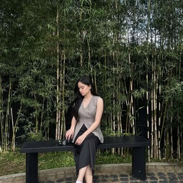
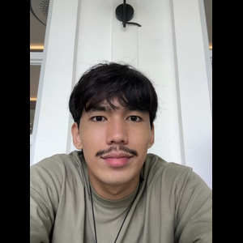
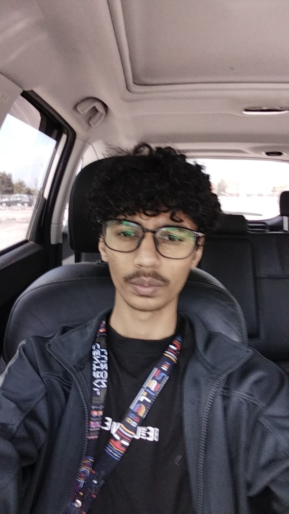
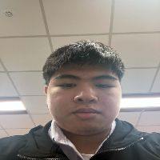
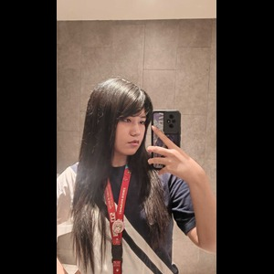

# 1. Cover Page and Team Roster

# Tapedeck

**Media Player Application Project – Documentation Portfolio**

| | |
|---|---|
| **Course** | OOP10 – Object-Oriented Programming with C# and Windows Forms |
| **Instructor** | Prof. Ulysses Raymond F. Monsale |
| **Section / Group / Team** | BSCS 2-A / OOP Group 3 / Tapedeck |
| **Repository** | https://github.com/joeycuison333-stack/Tapedeck-OOP10 (private) |

---

## Team Roster

| Photo | Member | Role | Contact | GitHub |
|---|---|---|---|---|
|  | **Joey Cuison** (team lead) | Team lead / repository owner; player engine, UI and integration | joeycuison333@gmail.com | [joeycuison333-stack](https://github.com/joeycuison333-stack) |
|  | **Sean Caling** (Heaven) | Core logic and file I/O: library saving and loading; deployment | seankeithheaven@gmail.com | [SeanC1801](https://github.com/SeanC1801) |
|  | **Ammaar Azmy** | Sorting and searching; requirements and class diagram | ammaarazmy2007@gmail.com | [aksilol](https://github.com/aksilol) |
|  | **Christian Maddox Rivera** (Maddox) | UI design and skin; splash screen | rivera.christianmaddox@student.auf.edu.ph | [Maddox44907](https://github.com/Maddox44907) |
|  | **Genevieve Valencia** | Testing and documentation; favorites and ratings enhancement | gdvalencia67@gmail.com | [gdvalenciah](https://github.com/gdvalenciah) |

The full role matrix (main classes and documentation sections per member) is in `04_Version_Control.md` Section 5.3.
