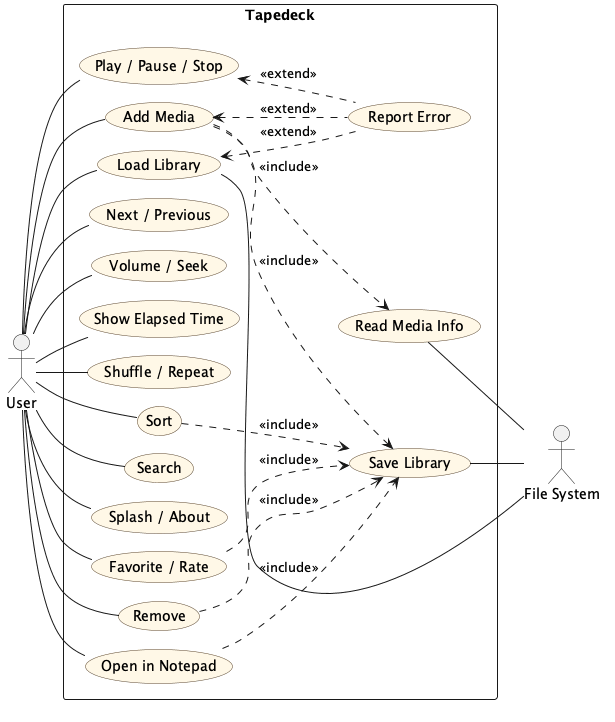
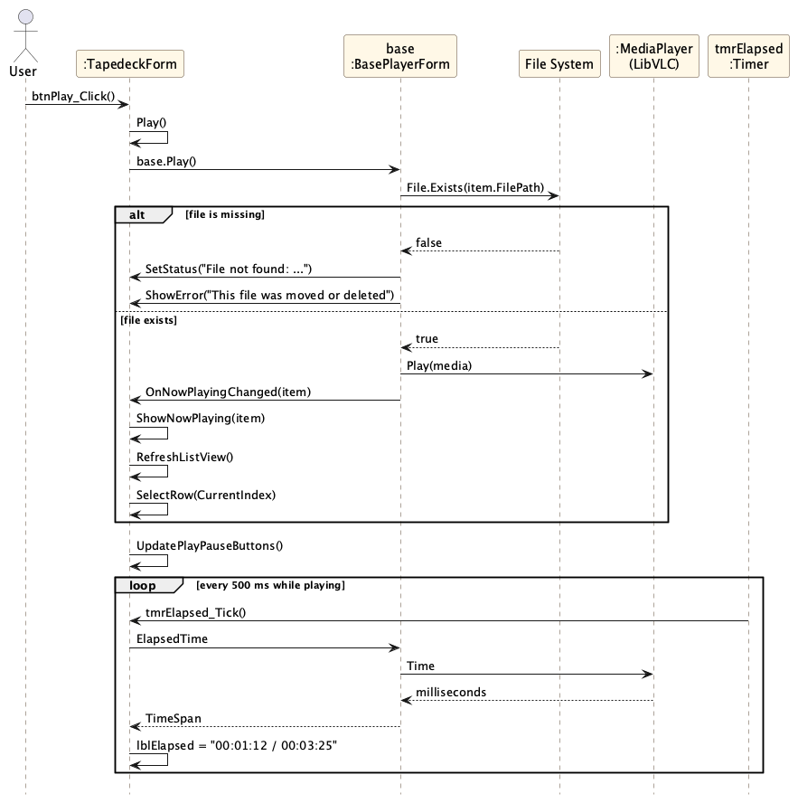
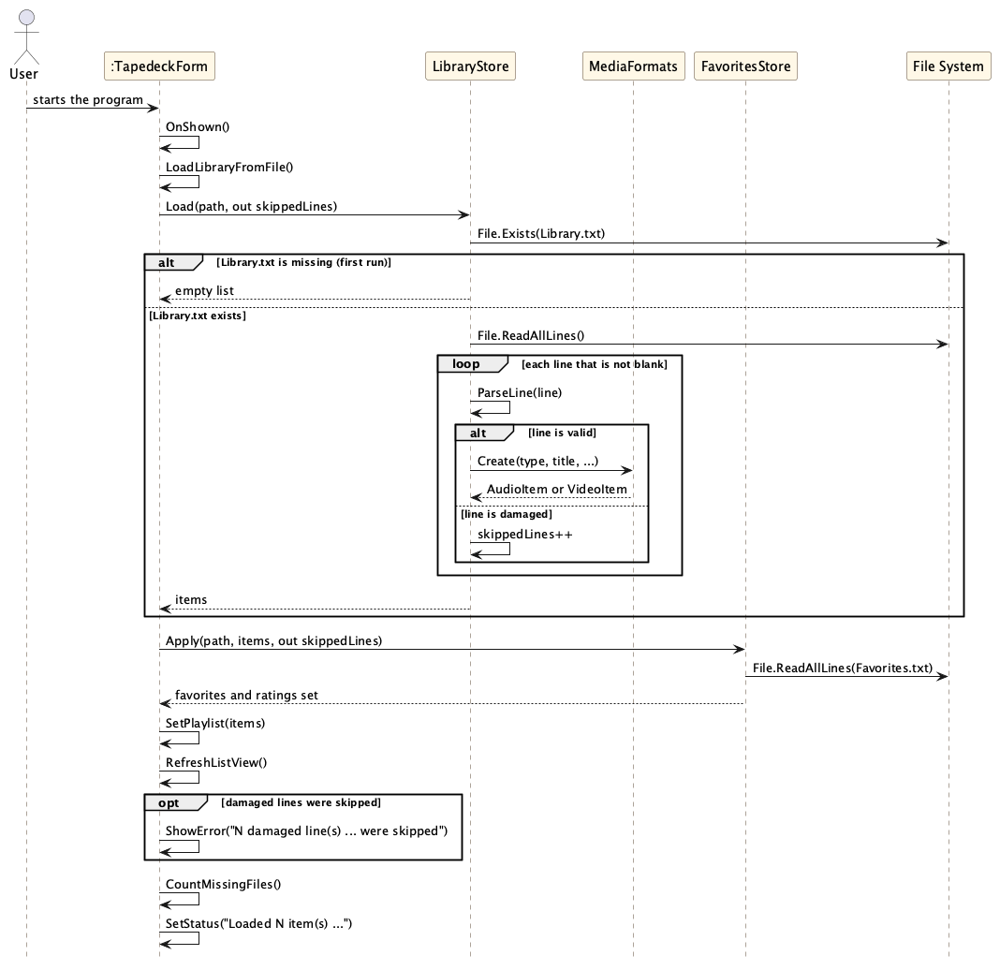

# 3. UML Part A – Use Cases and Sequence Diagrams

**Project:** Tapedeck (OOP10 media player) · **OOP Group 3 – BSCS 2-A** · **Author:** Heaven

This part shows *what* the user can do with Tapedeck (use cases) and *how* the objects work together for two key actions (sequence diagrams). The class diagram is in `02b_UML_Class_and_Sorting.md` (Ammaar).

---

## 3.1 Use case diagram

Source: [`diagrams/use_case_diagram.puml`](diagrams/use_case_diagram.puml) (PlantUML).

**Actors**

| Actor | Who or what |
|---|---|
| **User** | The person using the player: a student or casual listener on Windows 10/11. |
| **File System** | The disk: the user's mp3/mp4 files, `Library.txt` and `Favorites.txt` next to `Tapedeck.exe`. |

**Relationships**

- **«include» Save Library:** Add Media, Sort, Favorite / Rate, Remove and Open in Notepad always save the library afterwards, so a change is never lost.
- **«include» Read Media Info:** Add Media always reads the title, artist, duration and album or resolution of each file.
- **«extend» Report Error:** Load Library, Play and Add Media show an error only when something goes wrong (a damaged line, a missing file, an unsupported format). The normal flow does not need it. Saving can also fail (for example no permission to write); that case is described under Save / Load Library and is left off the diagram to keep it readable.

### Use case descriptions

#### Add Media
| | |
|---|---|
| **Actor** | User (File System) |
| **Goal** | Put mp3 and mp4 files into the library. |
| **Trigger** | **Add** / **Add Folder** button, Ctrl+O or Ctrl+Shift+O. |
| **Main flow** | 1. The user picks files or a folder. 2. `AddFilesAsync` skips files already in the library. 3. For each file, `ReadMediaItemAsync` reads its information and builds an `AudioItem` or `VideoItem`. 4. The items are added to the playlist and shown in the list. 5. The library is saved (`SaveLibraryToFile`). 6. The status bar says how many were added. |
| **Alternate flow** | A file that is not mp3/mp4, or cannot be read, is skipped and counted. The user sees one message with the counts (Report Error). A folder with no media files only shows a status message. |

#### Play Media
| | |
|---|---|
| **Actor** | User |
| **Goal** | Listen to or watch an item. |
| **Trigger** | **Play** button, F5, double-click or Enter on a row. |
| **Main flow** | 1. The selected row becomes `CurrentIndex`. 2. `Play` loads the file into LibVLC and starts it. 3. `OnNowPlayingChanged` fills the Now Playing area and highlights the row. 4. The timer updates the elapsed time every 500 ms. |
| **Alternate flow** | Empty library: "The library is empty" message. The file was moved or deleted: playback stops and the user sees the missing path (Report Error). Paused item: Play resumes it instead of restarting. |

#### Save / Load Library
| | |
|---|---|
| **Actor** | User (File System) |
| **Goal** | Keep the library between runs (FR3). |
| **Trigger** | Load: the program starts, or File > Reload Library (Ctrl+Shift+L). Save: Ctrl+S, closing the program, or any change (include). |
| **Main flow** | **Load:** 1. `LibraryStore.Load` reads `Library.txt` line by line and `ParseLine` turns each line into an item. 2. `FavoritesStore.Apply` restores favorites and ratings. 3. The list is shown and the status says "Loaded N item(s)". **Save:** 1. `LibraryStore.Save` writes every item to `Library.txt.tmp`, then replaces `Library.txt`. 2. `FavoritesStore.Save` writes `Favorites.txt`. |
| **Alternate flow** | No `Library.txt` (first run): the library starts empty with the hint "Add files with Ctrl+O". Damaged lines are skipped and counted, and the rest still loads (Report Error). Media files that no longer exist are greyed out and counted. The file cannot be read or written: an error message (for saving, a hint to move the program to Documents). |

#### Sort
| | |
|---|---|
| **Actor** | User |
| **Goal** | Order the library by title, artist, album/resolution, duration or rating. |
| **Trigger** | Library menu, Ctrl+1 to Ctrl+5, or a column header click. |
| **Main flow** | 1. The user picks a sort key. 2. `SortLibrary` copies the playlist and sorts the copy with the hand-written insertion sort (`LibrarySorter.InsertionSort`). 3. `SetPlaylist` swaps in the sorted copy, so the playing item stays current. 4. The list is redrawn and the library is saved. 5. The status says "Sorted by … (insertion sort)". |
| **Alternate flow** | Fewer than two items: there is nothing to sort, so nothing changes. |

#### Search
| | |
|---|---|
| **Actor** | User |
| **Goal** | Find an item by title or artist. |
| **Trigger** | Ctrl+F, type in the search box, then **Search** or Enter. |
| **Main flow** | 1. The user types a title, or part of a title or artist. 2. `SearchLibrary` sorts the library by title, then tries a binary search for the exact title. 3. If that finds nothing, it looks for the first title or artist containing the text. 4. The matching row is selected and the status names the method used. |
| **Alternate flow** | Blank text or an empty library: a status message only. No match: "No match for …" status message. |

#### Shuffle / Repeat
| | |
|---|---|
| **Actor** | User |
| **Goal** | Change the playing order and what happens at the end of an item. |
| **Trigger** | Shuffle / Repeat buttons, Ctrl+H, Ctrl+R. |
| **Main flow** | 1. Shuffle switches on or off; Repeat cycles Off → All → One (`CycleRepeat`). 2. The buttons and menu show the new mode. 3. When an item ends, the next one starts automatically: a random item (shuffle), the same item (Repeat One), or the next one, wrapping to the first (Repeat All). |
| **Alternate flow** | Repeat Off and the last item ends: playback stops. |

#### Favorite / Rate
| | |
|---|---|
| **Actor** | User (File System) |
| **Goal** | Mark favorites and give 1–5 stars (FR8). |
| **Trigger** | **♥ Fav** button or Ctrl+D; the rating box. |
| **Main flow** | 1. The user selects an item. 2. `ToggleFavorite` flips the ♥, or `SetRating` sets 0–5 stars. 3. The ♥ / ★ column (and Now Playing, if it is the playing item) updates. 4. The library is saved, so `Favorites.txt` keeps the change. |
| **Alternate flow** | Favorite with nothing selected: the playing item is used; if nothing is playing either, a status message asks the user to select an item. Rating with nothing selected: a status message only. |

---

## 3.3 Sequence diagrams

Every message in these diagrams is a real method or property in the code (`UI/TapedeckForm*.cs`, `UI/BasePlayerForm.cs`, `Data/LibraryStore.cs`, `Data/FavoritesStore.cs`, `Core/MediaFormats.cs`).

### 3.3.1 User presses Play

Source: [`diagrams/sequence_play.puml`](diagrams/sequence_play.puml)

1. `btnPlay_Click` calls the form's `Play()` override, which calls `base.Play()` in `BasePlayerForm` (inheritance: the playback logic is written once in the base class).
2. **alt – file is missing:** `File.Exists` returns false, so the base class calls `SetStatus` and `ShowError`. These are virtual, so the form's own versions run and the message appears in the form's status bar.
3. **alt – file exists:** LibVLC's `MediaPlayer.Play(media)` starts the file, then the base class calls the hook `OnNowPlayingChanged(item)`. The form overrides it to fill Now Playing (`ShowNowPlaying`), redraw the list (`RefreshListView`) and highlight the row (`SelectRow`).
4. The form swaps the Play button for Pause (`UpdatePlayPauseButtons`).
5. **loop – every 500 ms:** the `tmrElapsed` timer calls `tmrElapsed_Tick`, which reads `ElapsedTime` (from LibVLC's `Time` in milliseconds) and shows elapsed / total time, for example `00:01:12 / 00:03:25` (FR11).

### 3.3.2 Load Library.txt at start-up

Source: [`diagrams/sequence_load_library.puml`](diagrams/sequence_load_library.puml)

1. When the window first appears, `OnShown` calls `LoadLibraryFromFile`.
2. The form calls `LibraryStore.Load`. **alt – first run:** there is no `Library.txt`, so an empty list comes back and no error is shown.
3. Otherwise every line is read. **loop – each line that is not blank:** `ParseLine` checks it. **alt – valid line:** the factory `MediaFormats.Create` builds an `AudioItem` or `VideoItem`, so `LibraryStore` never checks the media type itself (polymorphism). **alt – damaged line:** it is counted in `skippedLines` and loading continues.
4. `FavoritesStore.Apply` reads `Favorites.txt` and sets each item's favorite and rating.
5. The form shows the items (`SetPlaylist`, `RefreshListView`). **opt – damaged lines were skipped:** `ShowError` tells the user how many.
6. `CountMissingFiles` counts media files that were moved or deleted, and `SetStatus` shows "Loaded N item(s) ..." (or the empty-library hint).

Read errors (`IOException`, `UnauthorizedAccessException`) are caught in the form, which shows an error and starts with an empty library; they are left off the diagram to keep it readable.
