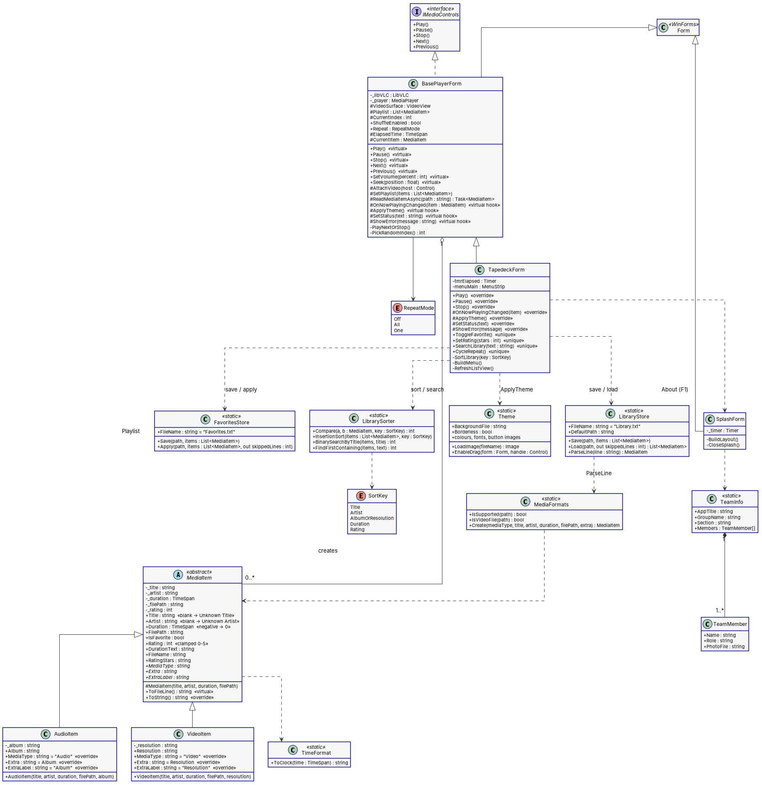

# 3. UML Part B – Class Diagram and Sorting Algorithm

**Project:** Tapedeck (OOP10 media player) · **OOP Group 2 – BSCS 2-A** · **Milestone:** M1–M3

The use case and sequence diagrams are in [`02a_UML_Use_Case_and_Sequence.md`](02a_UML_Use_Case_and_Sequence.md).

---

## 3.2 Class diagram



Source: [`diagrams/class_diagram.puml`](diagrams/class_diagram.puml) (PlantUML). Render it again after any change to a class:
`plantuml -tpng docs/diagrams/class_diagram.puml`

**Notation:** `+` public, `#` protected, `-` private; italic = abstract; hollow triangle = inheritance; dashed hollow triangle = implements an interface; hollow diamond = aggregation; filled diamond = composition; dashed arrow = uses (dependency).

## 3.3 How the design meets the OOP requirements (Section 3.2 of the guide)

| Requirement | Where in the code |
|---|---|
| **Interface** – `IMediaControls` declares Play, Pause, Stop, Next, Previous. | `Core/IMediaControls.cs`, implemented by `BasePlayerForm`. |
| **Abstraction and inheritance** – abstract `MediaItem` holds Title, Artist, Duration, FilePath; `AudioItem` and `VideoItem` inherit it and add Album / Resolution. | `Core/MediaItem.cs`, `AudioItem.cs`, `VideoItem.cs`. `MediaType`, `Extra` and `ExtraLabel` are abstract and overridden in each subclass. |
| **Base player** – `BasePlayerForm` implements `IMediaControls`; the group's form inherits from it, overrides at least two virtual members and adds at least one unique member. | `TapedeckForm : BasePlayerForm` overrides **Play, Pause, Stop, OnNowPlayingChanged, ApplyTheme, SetStatus, ShowError** (7) and adds **ToggleFavorite, SetRating, SearchLibrary, CycleRepeat** (4 unique public members). |
| **Polymorphism** – the playlist is a `List<MediaItem>`; code works through the base type, no long if-else type checks. | `BasePlayerForm.Playlist`. The list view and Now Playing call `item.Extra` / `item.ExtraLabel` / `item.MediaType` and get the album or the resolution without checking the type. `MediaFormats.Create` is the only place that chooses between `AudioItem` and `VideoItem` (when reading a line of `Library.txt`). |
| **Encapsulation** – properties with validation. | `MediaItem.Title` (blank → "Unknown Title"), `Artist` (blank → "Unknown Artist"), `Duration` (negative → 0), `Rating` (clamped 0–5); `AudioItem.Album`, `VideoItem.Resolution`. Fields are private. |
| **Separation of concerns** – file I/O, data classes and UI in separate classes; a Theme class holds all skin settings. | File I/O: `Data/LibraryStore.cs`, `Data/FavoritesStore.cs`. Data: `Core/`. UI: `UI/`. Skin: `UI/Theme.cs` + `TapedeckForm.ApplyTheme()`. |

### Relationships in the diagram
- `AudioItem` and `VideoItem` **inherit** `MediaItem`.
- `BasePlayerForm` **inherits** `Form` and **implements** `IMediaControls`; `TapedeckForm` **inherits** `BasePlayerForm`.
- `BasePlayerForm` **aggregates** 0..* `MediaItem` objects (the `Playlist`); the items exist on their own and are saved to disk.
- `TeamInfo` is **composed** of 1..* `TeamMember`.
- `TapedeckForm` **uses** `LibraryStore`, `FavoritesStore`, `LibrarySorter`, `Theme` and `SplashForm` (static helper classes, so the relationship is a dependency, not ownership).

## 3.4 Sorting algorithm (FR12)

### Which algorithm and why
We chose **insertion sort** (`LibrarySorter.InsertionSort`). It is written by hand; `List.Sort` and `OrderBy` are not used.

1. **Stable:** items that compare equal keep their order. Sorting by title and then by artist gives a list grouped by artist with titles still A–Z inside each artist.
2. **Fast on nearly sorted lists:** after the library is sorted once, adding a few files and sorting again costs close to O(n).
3. **In place and short:** it needs no extra list and is about ten lines, so every member can explain it.
4. A media library has tens to a few hundred items, so the O(n²) worst case is not noticeable.

Selection sort is not stable, and bubble sort does more swaps for the same result, so we did not use them.

### How it works
The list is split into a sorted part (left) and an unsorted part (right). Each step takes the first unsorted item (`current`), shifts every larger item in the sorted part one place to the right, and puts `current` into the gap.

```csharp
for (int i = 1; i < items.Count; i++)
{
    MediaItem current = items[i];
    int j = i - 1;
    while (j >= 0 && Compare(items[j], current, key) > 0)
    {
        items[j + 1] = items[j];   // shift the larger item right
        j--;
    }
    items[j + 1] = current;        // insert into the gap
}
```

`Compare` decides the order for each `SortKey`: Title, Artist and Album/Resolution A–Z (ignoring letter case), Duration shortest first, Rating highest first.

### Trace on a small list (sort by title)
Start: **[Delta, Alpha, Charlie, Bravo]**. The sorted part is shown in brackets.

| Step | current | Comparisons | Shifts | List after the step |
|---|---|---|---|---|
| start | – | – | – | [Delta] Alpha Charlie Bravo |
| i = 1 | Alpha | Delta > Alpha → shift; reached start | 1 | [Alpha Delta] Charlie Bravo |
| i = 2 | Charlie | Delta > Charlie → shift; Alpha < Charlie → stop | 1 | [Alpha Charlie Delta] Bravo |
| i = 3 | Bravo | Delta > Bravo → shift; Charlie > Bravo → shift; Alpha < Bravo → stop | 2 | [Alpha Bravo Charlie Delta] |

Total: 6 comparisons and 4 shifts.

### Running time
| Case | When it happens | Comparisons | Big-O |
|---|---|---|---|
| **Best** | The list is already sorted. Each item is compared once with its left neighbour and does not move. | n − 1 | **O(n)** |
| **Worst** | The list is in reverse order. Each item moves to the front. | n(n − 1) / 2 | **O(n²)** |
| Average | Random order | about n² / 4 | O(n²) |

Extra memory: O(1). The form sorts a **copy** of the playlist (`new List<MediaItem>(Playlist)`), then calls `SetPlaylist`, which finds the playing item again so the current song stays selected.

### Searching (FR6)
`SearchLibrary` first sorts by title, then uses **binary search** (`LibrarySorter.BinarySearchByTitle`) for an exact title. Each step looks at the middle item and throws away the half that cannot contain the title, so it takes **O(log n)** comparisons. If there is no exact title, `FindFirstContaining` checks each item's title and artist for the typed text (**O(n)**), so a partial word such as "sun" still finds "Sunrise" by "The Examples".

Trace: binary search for **"Charlie"** in [Alpha, Bravo, Charlie, Delta]:

| low | high | middle | items[middle] | Result |
|---|---|---|---|---|
| 0 | 3 | 1 | Bravo | Bravo < Charlie → low = 2 |
| 2 | 3 | 2 | Charlie | found at index 2 |

## 3.5 Where to find each sort and search action
| Action | Shortcut | Code |
|---|---|---|
| Sort by Title / Artist / Album-Resolution / Duration / Rating | Ctrl+1 … Ctrl+5, or click the column header | `TapedeckForm.SortSearch.cs`: `SortLibrary`, `listView1_ColumnClick` |
| Search | Ctrl+F, type, then Enter or **Search** | `SearchLibrary`, `txtSearch_KeyDown`, `btnSearch_Click` |
