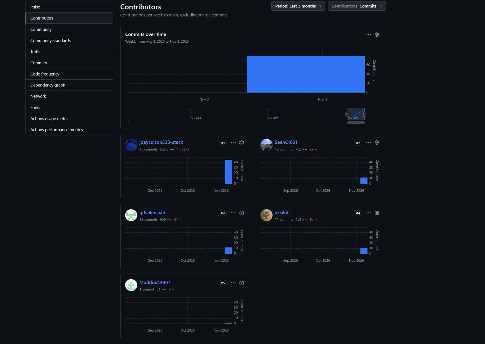

# 5. Version Control and Collaboration Record

## 5.1 Repository
- **Host:** GitHub, private repository `Tapedeck-OOP10` under the team lead's account.
- **Repository link:** https://github.com/joeycuison333-stack/Tapedeck-OOP10
- **Collaborators (write access):** Sean Caling / Heaven (`SeanC1801`), Ammaar Azmy (`aksilol`), Christian Maddox Rivera (`Maddox44907`), Genevieve Valencia (`gdvalenciah`). Owner: Joey Cuison (`joeycuison333-stack`).
- **Instructor:** Prof. Ulysses Raymond F. Monsale – to be added under Settings → Collaborators.
- **Files:** `README.md`, `PRD.md`, Visual Studio `.gitignore` (`bin/`, `obj/`, `.vs/` and publish output are not committed), `Tapedeck.sln`, `Tapedeck/Tapedeck.csproj`, `docs/`.

## 5.2 Branching and merging
- `main` always compiles — verified after every one of Joey's foundation commits (`dotnet build`, 0 errors) and again after `dotnet publish -c Release`.
- One branch per feature (see PRD.md Section 6 for each member's branches).
- **No member depends on another:** Joey pushed a working foundation (`J1`–`J14`) with placeholder versions of every teammate's file, so the app already builds and runs. Each member replaces only their own files; pull requests merge in any order without conflicts.
- Merge through a **pull request**; Joey reviews and merges, building after each merge (`J15`).
- Commit prefixes: `feat:`, `fix:`, `docs:`, `test:`, `refactor:`, `build:`, `chore:`. At least **10 meaningful commits per member**.

## 5.3 Role matrix

| Member (GitHub) | Primary role | Main classes / files | Documentation section |
|---|---|---|---|
| **Joey Cuison** (leader) `joeycuison333-stack` | Foundation, playback engine, UI and integration; repository owner, merges every PR | `IMediaControls.cs`, `RepeatMode.cs`, `TimeFormat.cs`, `MediaItem.cs`, `AudioItem.cs`, `VideoItem.cs`, `MediaFormats.cs`, `Theme.cs`, `BasePlayerForm.cs`, `TapedeckForm.cs` + `.Designer`, `.View`, `.AddMedia`, `.Playback`, `.Menu`, `Program.cs`, release build | 4 Development log, 5 Version control |
| **Sean Caling** (Heaven) `SeanC1801` | Library saving, loading and deployment | `LibraryStore.cs`, `FavoritesStore.cs`, `TapedeckForm.Library.cs`, test data | 3 UML Part A (use case, sequence), 8 Deployment guide |
| **Ammaar Azmy** `aksilol` | Sorting and searching | `LibrarySorter.cs`, `TapedeckForm.SortSearch.cs` | 2 Requirements, 3 UML Part B (class diagram, sorting) |
| **Christian Maddox Rivera** (Maddox) `Maddox44907` | Skin design and splash screen | `TeamInfo.cs`, `SplashForm.cs`, `Assets/` (Canva) | Design concept, credits, slides |
| **Genevieve Valencia** `gdvalenciah` | Favorites, testing and user manual | `TapedeckForm.Favorites.cs` | Cover, 6 Test plan and bug log, 7 User manual, 9 Presentation and reflections, portfolio assembly |

## 5.4 Merge conflict note
Conflicts were mostly avoided by design: the form is split into partial-class files with one owner each, and every member edits only their own files. Two conflicts still happened:

| # | Pull request | Files | How it was resolved |
|---|---|---|---|
| 1 | `feature/splash` into `main` (PR #13, fixed through `fix/splash-conflict`, PR #16) | Splash skin image (`Assets/` background) | Kept the newer version of the image, then rebuilt and checked the splash screen. |
| 2 | `test/test-plan` into `main` (M4, PRs #21 and #24) | `docs/05_Testing.md`, `docs/06_User_Manual.md` | Merged both versions: kept the executed test results, bug log and full user manual from the testing branch, and the M4 updates from `main`. |

**Commit messages:** most commits use the `feat:`, `fix:`, `docs:`, `test:`, `refactor:` prefixes. A few early commits (mostly in Heaven's `feature/library-store` and `docs/uml-deployment` branches, and Ammaar's A8–A10 commits) were made without a prefix; they were left as they are rather than rewriting shared history.

## 5.5 Meeting log

The team met online in its Messenger group chat; decisions were posted there and in the shared Google Drive folder.

| Date | Attendees | Decisions |
|---|---|---|
| Nov 8 (Sun) | All five (group chat) | Group formed from the OOP10 project groupings. The project requirements PDF and the development plan (M1–M5 due dates) were shared. Members sent their GitHub accounts and emails so they could be added to the repository. Chose the app name and theme (Tapedeck, retro cassette look), the enhancement (favorites and ratings), the sorting algorithm (insertion sort), and the roles in 5.3. |
| Nov 9 (Mon) | All five (group chat) | Progress review for the Nov 10 deliverables (M1–M3): merged work checked (library saving and loading, sorter, foundation and release configuration) and the remaining tasks listed per member. Agreed to finish the Nov 10 tasks by 9 PM. |
| Nov 9–10 | Joey, Maddox, Ammaar, Genevieve (group chat) | Maddox to remove the baked-in title, group and menu text from the skin PNG and add the remaining team photos; Ammaar and Genevieve sent their photos for the splash screen. |
| Nov 12 (Thu) | All five (group chat) | Presentation script shared. Deadlines set: M4 deliverable on Nov 12, voice-overs on Nov 13 at 10 PM, M5 (final video, documentation and repository) on Nov 14. Each member uploads their voice-over to their own folder in the shared Drive. The M4 documentation (`G3_BSCS2A_M4.pdf`) was submitted that night. |
| Nov 13 (Fri) | All five (group chat) | Agreed that the final presentation is a narrated video, with each member recording a voice-over for their own part of the script; follow-up on the voice-overs. |
| Nov 14 (Sat) | All five (group chat) | The documentation portfolio (sections 1–9 and appendix) assigned to Sean Caling (Heaven), who accepted. Final submission: repository, portfolio PDF, release ZIP and recorded demonstration. |

## 5.6 Commit history

*Figure: GitHub → Insights → Contributors (commits to `main`, excluding merge commits).*

Commits per member on `main`, excluding merge commits, counted with `git shortlog -sn --no-merges main` (uses the repository's `.mailmap`):

| Member | GitHub | Commits |
|---|---|---|
| Joey Cuison | joeycuison333-stack | 45 |
| Christian Maddox Rivera (Maddox) | Maddox44907 | 17 |
| Genevieve Valencia | gdvalenciah | 12 |
| Sean Caling (Heaven) | SeanC1801 | 12 |
| Ammaar Azmy | aksilol | 11 |

Every member has at least 10 commits.

**Note on Maddox's count:** GitHub's Contributors page shows only 1 commit for `Maddox44907`. 15 of his 17 commits were made with a misspelled Git email (`rivera.chrsitianmaddox@…` instead of `rivera.christianmaddox@…`), and GitHub only credits a commit to an account when its email matches one linked to that account. The commits themselves are in the history under his name (splash screen, team info, member photos, Canva skin, logo and icon, design concept, credits). The `.mailmap` file maps both emails to him so Git counts them correctly; the history was not rewritten, so no commit IDs changed. His two latest commits already use the correct address.
