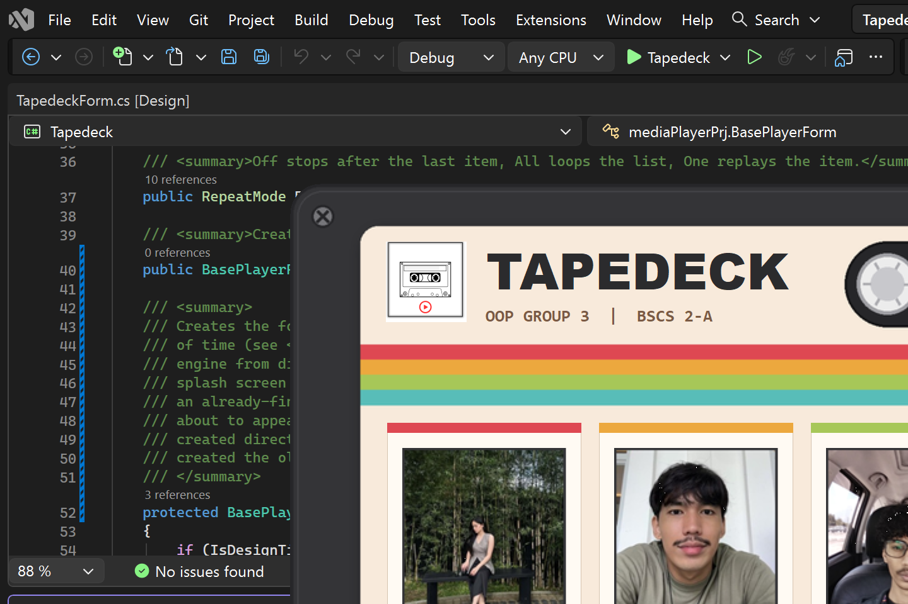

# 6. User Manual

**Project:** Tapedeck (OOP10 media player) · **OOP Group 3 – BSCS 2-A**
**For:** anyone running the released `Tapedeck.exe` — no programming knowledge needed.
**Companion documents:** `07_Deployment_Guide.md` (how to build and install it), `05_Testing.md` (what has been tested).

---

## 1. What Tapedeck is

Tapedeck is a simple desktop media player for **MP3 audio** and **MP4 video**, styled like a retro cassette tape. You add files or whole folders to a library, play them with on-screen buttons or keyboard shortcuts, sort and search the library, and mark favorites and star ratings. Your library, favorites and ratings are remembered automatically between sessions — there is nothing to save by hand.

Tapedeck only plays `.mp3` and `.mp4` files. Any other file type is skipped with a message explaining why.

---

## 2. Installing and starting Tapedeck

1. Get `G3_BSCS2A_Release.zip` from your instructor or teammate and extract it fully to a normal folder you can write to, such as `Documents\Tapedeck` — **not** `C:\Program Files` or another protected folder, and don't run it from inside the ZIP (see `07_Deployment_Guide.md` for why).
2. Double-click `Tapedeck.exe` inside the extracted folder.
3. If Windows shows **"Windows protected your PC"**, click **More info → Run anyway**. This is normal for a program that was not purchased from the Microsoft Store; it is not a sign anything is wrong.
4. No separate installation of VLC, codecs, or the .NET runtime is required — everything the program needs is already in the folder.

### The splash screen

When Tapedeck starts, it shows this cassette-style splash screen for about three seconds, with the Tapedeck logo, the app name, the group and section, and a card for every team member (photo, name, role). You don't have to wait — **click anywhere on it, or press any key**, and it closes immediately and opens the player.

---

## 3. The main window, at a glance

The main window keeps the retro skin: a dark title bar with the Tapedeck logo and group name at the top, a video area and Now Playing panel on the left, and the library list on the right with its own toolbar. The bottom edge has the status bar and item count, and the transport controls (Previous / Play / Stop / Next, volume, Shuffle and Repeat) sit under the video area.

| Area | What it's for |
|---|---|
| **Video area** (top left, black) | Shows video playback. For audio tracks it just stays black — there is nothing wrong. |
| **Now Playing panel** | Large title and artist of the current track, plus media type, album or resolution, favorite/rating, and the elapsed-time / total-length readout. |
| **Seek bar** | Drag it, or click it and use the Left/Right arrow keys, to jump to a position in the current track. |
| **Transport buttons** | Previous, Play/Pause (one button that swaps icon), Stop, Next, Shuffle, Repeat, and the volume slider. |
| **Library list** (right) | Every file you've added: Title, Artist, Album/Resolution, Length, and a ♥ / ★ column for favorites and ratings. Click a column header to sort by it. |
| **Library toolbar** | Add, Add Folder, Remove, Search box + Search button, Favorite toggle, and the rating dropdown. |
| **Menu bar** (under the title bar) | File, Playback, Library, Help — every action is also available here, each with its keyboard shortcut shown next to it. |
| **Status bar** (bottom) | The last thing that happened ("Added 3 item(s).", "Sorted by Title (insertion sort).", error messages, etc.) and the total item count. |

A row for a file that has been moved, renamed, or deleted outside Tapedeck shows up **greyed out** in the library — see Section 7.

---

## 4. Building your library

### Add files

Click **Add** (toolbar) or **File > Add Files...** (`Ctrl+O`). Pick one or more `.mp3`/`.mp4` files in the dialog and click Open. Each file is read for its title, artist, duration, and album (audio) or resolution (video); anything already in your library is skipped as a duplicate instead of being added twice, and the status bar reports how many were added, how many were already there, how many were skipped (wrong file type), and how many could not be read.

### Add a whole folder

Click **Add Folder** or **File > Add Folder...** (`Ctrl+Shift+O`). Choose a folder, and Tapedeck scans it **and every subfolder** for `.mp3`/`.mp4` files and adds everything it finds, with the same summary message as above.

### Remove an item

Select a row and click **Remove**, press **Delete**, or use **Library > Remove Selected**. If the item you removed was currently playing, playback stops first so nothing keeps playing "off the list".

### Your library is saved automatically

Every time you add or remove files, toggle a favorite, change a rating, or close the program, your library is written to a file called `Library.txt` (and favorites/ratings to `Favorites.txt`) **in the same folder as `Tapedeck.exe`**. You never have to click a separate "Save" — though **File > Save Library** (`Ctrl+S`) is there if you want to force it. The next time you start Tapedeck, both files are read back in automatically.

> If the program folder is read-only (for example `C:\Program Files`), saving will fail with a clear message telling you to move the program to a normal folder such as Documents. This is expected — Windows protects that folder from ordinary programs.

### Editing the library by hand (advanced)

**File > Open Library in Notepad** (`Ctrl+L`) saves your current library, then opens `Library.txt` in Notepad so you can inspect or hand-edit it — one line per item, `Type|Title|Artist|hh:mm:ss|FilePath|Extra`. After saving your changes in Notepad, use **File > Reload Library** (`Ctrl+Shift+L`) in Tapedeck to pick them up without restarting the program. A damaged or malformed line is simply skipped (and counted in a warning) rather than stopping the rest of your library from loading.

---

## 5. Playing media

| Action | Button | Shortcut |
|---|---|---|
| Play / resume | ▶ (toolbar) or double-click / Enter on a row | `F5` |
| Pause | ⏸ | `F6` |
| Stop | ■ | `F7` |
| Next track | ⏭ | `Ctrl+Right` |
| Previous track | ⏮ | `Ctrl+Left` |
| Volume up / down | drag the slider | `Ctrl+Up` / `Ctrl+Down` |
| Seek | drag the seek bar, or focus it and use arrow keys | — |
| Shuffle on/off | Shuffle button | `Ctrl+H` |
| Repeat Off → All → One | Repeat button (cycles on each press) | `Ctrl+R` |

Double-clicking a row (or selecting it and pressing Enter) plays that track immediately. Next and Previous wrap around — Next on the last track goes back to the first, Previous on the first track goes to the last — so you never hit a dead end. With **Repeat: Off**, playback simply stops after the last track finishes; with **Repeat: All** it loops back to the first track; with **Repeat: One** the same track replays. **Shuffle** picks the next track at random instead of the following one in the list (it won't immediately repeat the same track twice in a row).

If you press Play with nothing in your library yet, Tapedeck tells you so ("The library is empty. Add some files first.") instead of doing nothing silently.

---

## 6. Sorting, searching, favorites and ratings

### Sorting

Click any column header — **Title**, **Artist**, **Album/Resolution**, **Length**, or the **♥ ★** column — to sort the whole library by that column (the same options are under **Library** in the menu, `Ctrl+1` through `Ctrl+5`). Sorting never loses track of what's currently playing — it stays selected and keeps playing.

### Searching

Type a title or artist into the search box and press **Enter** or click **Search** (`Ctrl+F` focuses the box). Tapedeck first looks for an exact title match; if there isn't one, it looks for any title or artist that *contains* what you typed. If nothing matches, the status bar says so and your current selection doesn't change.

### Favorites and ratings

Select a track and click **♥ Fav** (or `Ctrl+D`, or **Library > Toggle Favorite**) to mark or unmark it as a favorite — the button's label flips between "♥ Fav" and "♥ Unfav" so you can always tell the current state. Use the star dropdown next to it to give the selected track a rating from 1 to 5 stars (or clear it back to unrated). Both show up in the **♥ ★** column of the library list (for example `♥ 5★`), in the Now Playing panel when that track is playing, and are remembered in `Favorites.txt` the same way the library itself is.

---

## 7. When something's not quite right

Tapedeck is built to keep working and tell you what happened, instead of crashing:

- **"The library is empty. Add some files first."** — you pressed Play (or a shortcut that needs a track) before adding anything. Use Add or Add Folder.
- **A row is greyed out in the library** — the file it points to has been moved, renamed, or deleted outside Tapedeck. Trying to play it shows *"This file was moved or deleted: \<path\>"*; remove the row and re-add the file from its new location if you still have it.
- **"N skipped: only .mp3 and .mp4 are supported."** — you tried to add a file type Tapedeck doesn't play (`.wav`, `.flac`, `.jpg`, etc.). Nothing was added for those files; anything that *was* a valid mp3/mp4 in the same batch is still added normally.
- **"N damaged line(s) in Library.txt were skipped."** — `Library.txt` had one or more lines that didn't parse (for example, hand-edited incorrectly in Notepad). Those specific lines are ignored; everything else in your library still loads.
- **"The library could not be saved."** — usually means the program folder is read-only. Move the Tapedeck folder to somewhere like Documents or your Desktop and try again.
- **A general error dialog** ("Something went wrong: ...") — an unexpected problem was caught before it could crash the program. The window stays open and usable; if you can reproduce it, note what you were doing (see Section 9).

---

## 8. Keyboard shortcuts (reference)

Also available any time from **Help > Keyboard Shortcuts** (`Ctrl+K`) inside the app.

| Shortcut | Action |
|---|---|
| `Ctrl+O` | Add files |
| `Ctrl+Shift+O` | Add folder |
| `Ctrl+S` | Save library |
| `Ctrl+Shift+L` | Reload library |
| `Ctrl+L` | Open library in Notepad |
| `Alt+F4` | Exit |
| `F5` / `F6` / `F7` | Play / Pause / Stop |
| `Ctrl+Right` / `Ctrl+Left` | Next / Previous |
| `Ctrl+Up` / `Ctrl+Down` | Volume up / down |
| `Ctrl+H` | Shuffle on/off |
| `Ctrl+R` | Cycle Repeat (Off → All → One) |
| `Ctrl+1`…`Ctrl+5` | Sort by Title / Artist / Album-Resolution / Length / Rating |
| `Ctrl+F` | Jump to the search box |
| `Ctrl+D` | Toggle favorite |
| `Delete` | Remove selected item |
| `F1` | About |

---

## 9. Getting help / reporting a problem

Tapedeck is a student project (OOP Group 3, BSCS 2-A). If you're a tester or teammate and find something that doesn't match this manual, please note:

1. What you did, step by step.
2. What you expected to happen.
3. What actually happened (copy the exact text of any message shown).
4. Whether it happens every time or only sometimes.

and add it to the bug log in `docs/05_Testing.md` (Section 6.3) so it can be tracked and fixed.

---

## Appendix: screenshots still to add

This manual ships with one real screenshot (the splash screen, Section 2), captured from the built `Tapedeck.exe`. The remaining screenshots called for by the project plan — the main window with a populated library, a track playing with the Now Playing panel filled in, the favorites/rating column, and an error dialog — need a short interactive session with the app and a couple of sample `.mp3`/`.mp4` files to produce (capturing them headlessly in this session was unreliable because other windows kept stealing focus on this machine). Drop the finished `.png` files into `docs/screenshots/` using the names below and they'll slot into this manual without any other changes:

| File | Shows |
|---|---|
| `main_window_library.png` | Main window with a few tracks loaded |
| `now_playing.png` | A track playing, Now Playing panel filled in |
| `favorites_ratings.png` | The ♥ ★ column with a mix of favorites and star ratings |
| `error_missing_file.png` | The "file was moved or deleted" dialog |
