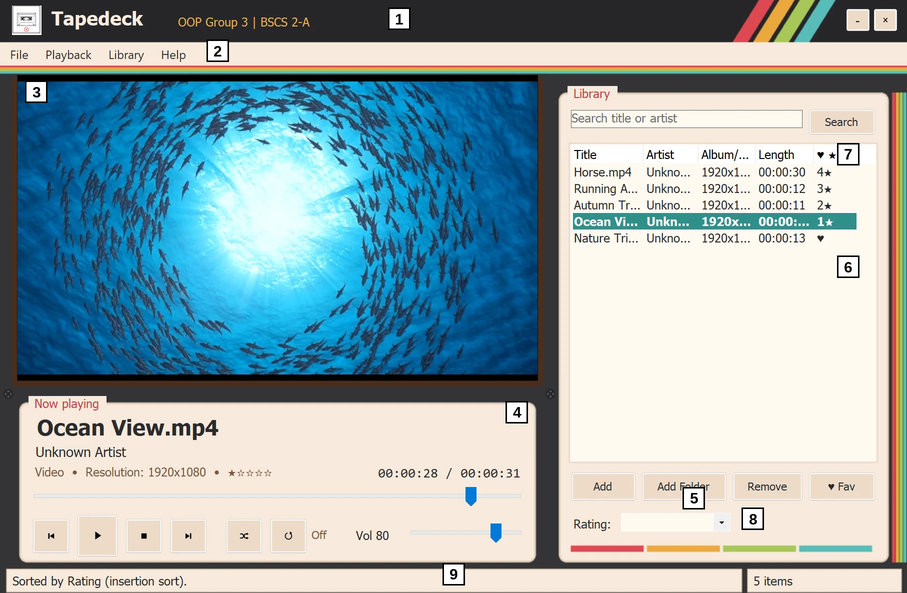
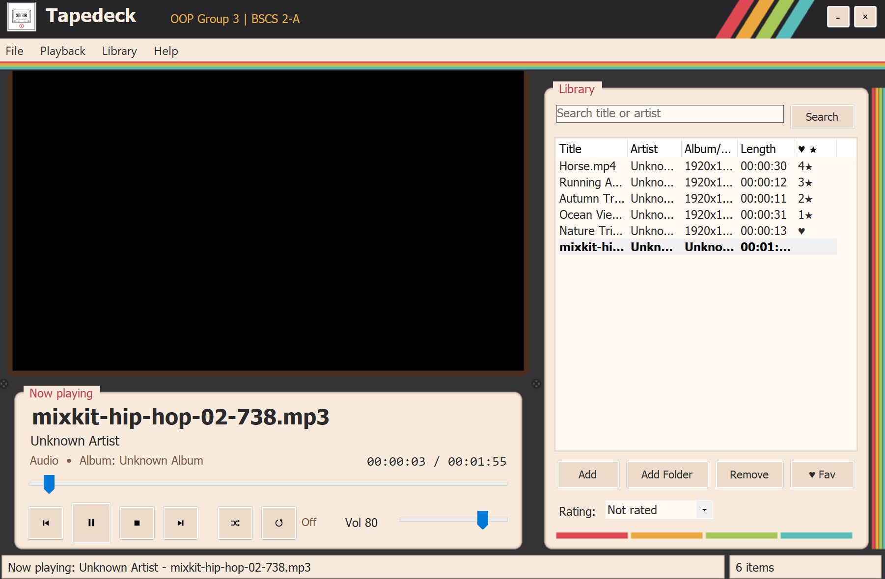
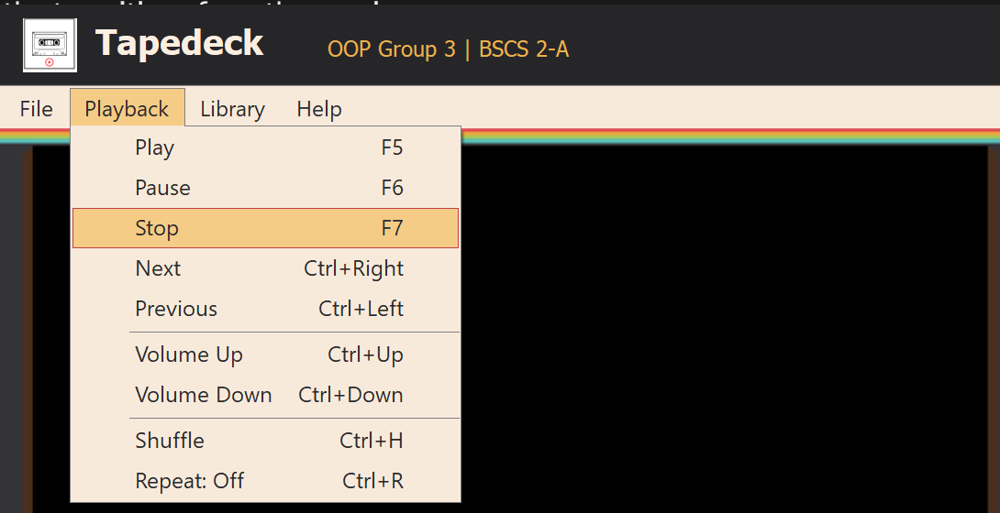
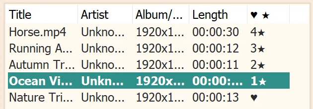
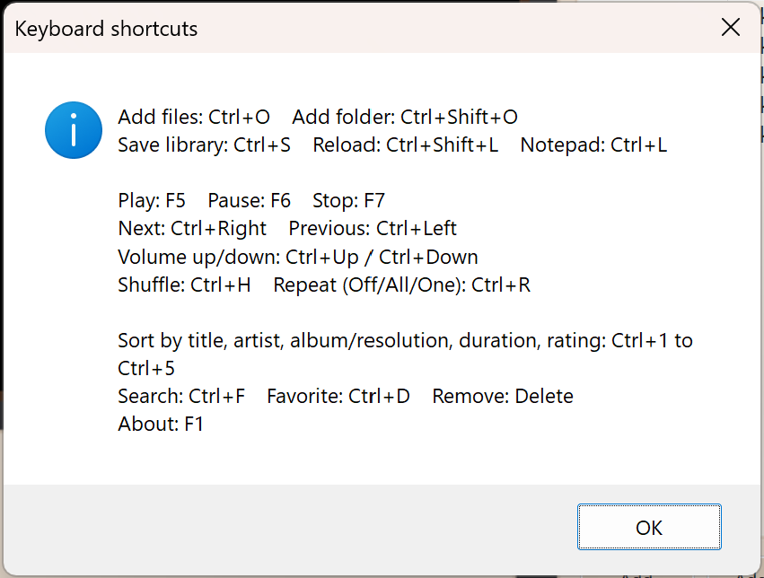
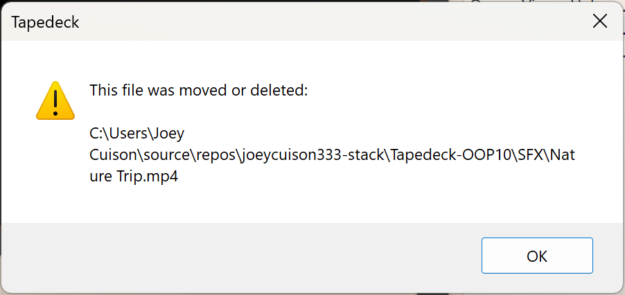

# 7. User Manual

**Project:** Tapedeck (OOP10 media player) · **OOP Group 3 – BSCS 2-A**
**Author:** Valencia Genevieve · **Screenshots:** Joey Cuison · **Updated:** November 12, 2026 (Milestone 4)
**Companion documents:** `07_Deployment_Guide.md` (building and installing), `05_Testing.md` (what has been tested)

---

## 7.1 Introduction and System Requirements

This manual explains how to install and use Tapedeck to build a library of MP3 and MP4 files and play them. Tapedeck is a Windows desktop application with a retro cassette-tape design.

**Table 7. System requirements**

| | |
|---|---|
| **Operating system** | Windows 10 or 11, 64-bit |
| **.NET runtime** | Not required. The release is self-contained and includes the .NET 8 runtime. |
| **Other software** | None. The VLC playback engine is included in the release. |
| **Disk space** | About 360 MB after extracting (the ZIP is about 152 MB) |
| **Display** | 1024 × 680 or larger; tested at 100%, 125% and 200% scaling |

## 7.2 Installation

1. Download **`G3_BSCS2A_Release.zip`**.
2. Extract the whole ZIP to a folder you can write to (for example Desktop or Documents, not Program Files), because `Library.txt` and `Favorites.txt` are created next to the program.
3. Open the extracted folder and run **`Tapedeck.exe`**. If Windows shows "Windows protected your PC", click **More info**, then **Run anyway**.
4. Keep the **Assets** and **libvlc** folders beside the program; the application needs them to show the skin and play media.

When Tapedeck starts, the splash screen shows the logo, application title, group and section, and a card for each member. It closes by itself after about three seconds, or at once on a click or key press.

**Figure 1. Splash screen**

## 7.3 The Main Window

**Figure 2. Main window with numbered annotations**

**Table 8. Main window elements**

| No. | Element | Function |
|---|---|---|
| 1 | Title bar | Logo, title, group and section; Minimize and Close buttons. Drag it to move the window. |
| 2 | Menu bar (File, Playback, Library, Help) | Every action, with its keyboard shortcut shown beside it. |
| 3 | Video panel | Shows video during MP4 playback; stays black for audio. |
| 4 | Now Playing area | Title, artist, media type, album or resolution, favorite and rating, elapsed time and total length, seek bar, playback buttons, Shuffle, Repeat and volume. |
| 5 | Library buttons | Add, Add Folder, Remove and ♥ Fav / ♥ Unfav. |
| 6 | Playlist / library list | All items with Title, Artist, Album/Resolution, Length and ♥ ★ columns; click a heading to sort. |
| 7 | Search box and button | Search by title (binary search) or by part of a title or artist. |
| 8 | Rating list | Gives the selected item 1 to 5 stars, or clears the rating. |
| 9 | Status bar and item count | The result of the last action or an error message, and the number of items. |

## 7.4 Adding Media

1. Step 1: choose **File > Add Files…** or press **Ctrl+O**. To add a whole folder and its subfolders, choose **File > Add Folder…** or press **Ctrl+Shift+O**.
2. Step 2: select one or more `.mp3` or `.mp4` files (hold Ctrl or Shift to select several).
3. Step 3: the items appear in the list and are saved to `Library.txt`. The status bar reports how many were added, how many were already in the library, and how many were skipped.

To remove an item, select it and click **Remove** or press **Delete**. To edit the library by hand, use **File > Open Library in Notepad** (Ctrl+L) and then **File > Reload Library** (Ctrl+Shift+L). Each line of `Library.txt` has the format `Type|Title|Artist|hh:mm:ss|FilePath|Album or Resolution`.

## 7.5 Playing Media

Double-click an item in the playlist, or select it and press Enter or **Play** (F5). The Now Playing area shows the item's title, artist and details, and the elapsed time counts up next to the total length (for example `00:00:41 / 00:03:02`). For video files, the picture plays in the video panel (Figure 2). For audio files the video panel stays black, and Now Playing shows "Audio" and the album (Figure 3).

Use the buttons or keyboard shortcuts to Pause (F6), Stop (F7), go to the Next item (Ctrl+Right) or the Previous item (Ctrl+Left). Adjust the volume with the slider or Ctrl+Up / Ctrl+Down, and drag the seek bar to jump to another position. When an item finishes, the next one starts automatically according to the shuffle and repeat settings.

**Figure 3. An mp3 playing: Now Playing shows the audio details and the elapsed time**

**Figure 4. The Playback menu with its shortcuts**

## 7.6 Sorting and Searching the Library

- **Sorting the library:** click any column heading (Title, Artist, Album/Resolution, Length or ♥ ★) or use the **Library** menu (Ctrl+1 to Ctrl+5). Sorting uses a hand-written insertion sort. If an item is playing, it stays selected and keeps playing.
- **Searching the library:** type a title or artist into the search box and press **Enter** or click **Search** (Ctrl+F moves to the box). Tapedeck first looks for an exact title with binary search, then for the first title or artist that contains the text. The status bar shows which method found the item, or "No match for …".

**Figure 5. Library sorted by rating, with favorites and star ratings**

## 7.7 Shuffle and Repeat

- **Shuffle mode:** click the Shuffle button or choose **Playback > Shuffle** (Ctrl+H). When shuffle is on, the next item is chosen at random and the same item is not played twice in a row.
- **Repeat mode:** click the Repeat button or choose **Playback > Repeat** (Ctrl+R) to cycle through the three states:
  - **Off:** playback stops when the last item finishes.
  - **All:** playback goes back to the first item and continues.
  - **One:** the current item replays until it is stopped or changed.

## 7.8 Favorites and Star Ratings

- **Marking a favorite:** select an item and click **♥ Fav** or press **Ctrl+D**. A ♥ appears in the ♥ ★ column and in Now Playing, and the button changes to **♥ Unfav**. Click it again to remove the favorite.
- **Rating an item:** select an item and choose 1 to 5 stars in the **Rating** list, or "Not rated" to clear it. The rating shows in the ♥ ★ column (for example "♥ 5★").
- Favorites and ratings are saved in `Favorites.txt` and restored the next time Tapedeck starts. Sort by rating with Ctrl+5 to see the highest-rated items first (Figure 5).

## 7.9 Keyboard Shortcuts

The shortcuts below match the final build. They are also shown inside the program under **Help > Keyboard Shortcuts** (Ctrl+K).

**Table 9. Keyboard shortcuts**

| Key | Action |
|---|---|
| **Ctrl+O / Ctrl+Shift+O** | Add files / Add folder |
| **Ctrl+S / Ctrl+Shift+L / Ctrl+L** | Save library / Reload library / Open library in Notepad |
| **F5 / F6 / F7** | Play / Pause / Stop |
| **Ctrl+Right / Ctrl+Left** | Next / Previous |
| **Ctrl+Up / Ctrl+Down** | Volume up / down by 10 |
| **Ctrl+H** | Shuffle on / off |
| **Ctrl+R** | Repeat Off, All, One |
| **Ctrl+1 / Ctrl+2 / Ctrl+3 / Ctrl+4 / Ctrl+5** | Sort by Title / Artist / Album or Resolution / Length / Rating |
| **Ctrl+F** | Go to the search box |
| **Ctrl+D** | Toggle favorite |
| **Delete** | Remove the selected item |
| **Ctrl+K** | Show the keyboard shortcuts |
| **F1** | About (shows the splash screen) |
| **Alt+F4** | Exit |

**Figure 6. Help > Keyboard Shortcuts**

## 7.10 Troubleshooting

**Table 10. Troubleshooting**

| Problem | Message shown | What to do |
|---|---|---|
| A file in the library was moved or deleted | "This file was moved or deleted: [path]" (row shown in grey) | Remove the row and add the file again from its new location. |
| Some library lines are damaged | "[N] damaged line(s) in Library.txt were skipped." | The rest still loads. Fix or delete the line with Ctrl+L, then reload with Ctrl+Shift+L. |
| A file is not an MP3 or MP4 | "[N] skipped: only .mp3 and .mp4 are supported." | Add only `.mp3` and `.mp4` files. |
| A file is locked or damaged | "[N] could not be read." | Close the program using the file, or use another copy. |
| Play is pressed with an empty library | "The library is empty. Add some files first." | Press Ctrl+O to add files. |
| The library cannot be saved | "The library could not be saved." / "No permission to save the library." | Move the Tapedeck folder out of Program Files to Documents or the Desktop. |
| Skin or team photos do not appear | "Skin not loaded, using plain colours." | Check that the Assets folder is beside `Tapedeck.exe`. |
| Video or audio does not play | "The VLC files were not found next to the program." | Check that the libvlc folder is beside `Tapedeck.exe`; extract the whole ZIP again. |

**Figure 7. Message for a file that was moved or deleted**
